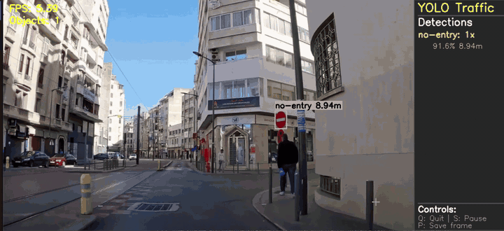
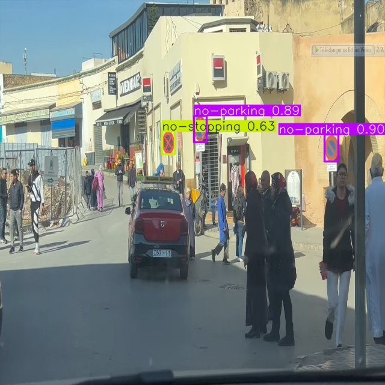
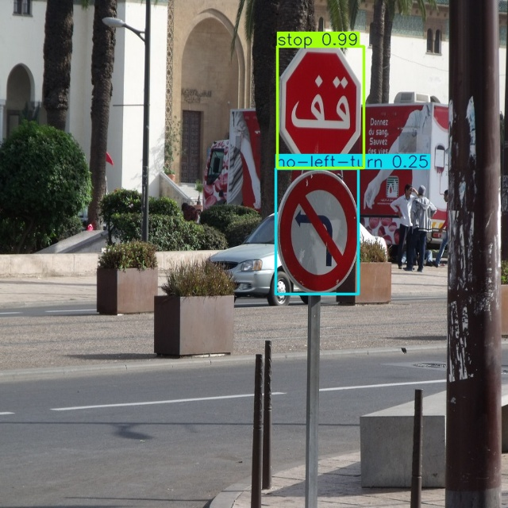
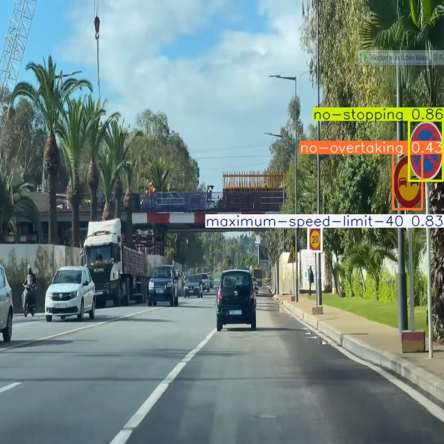
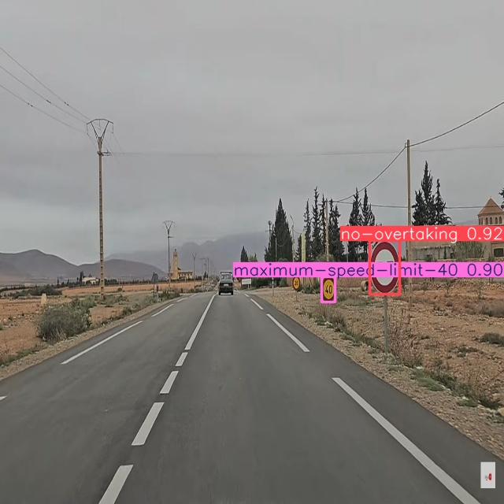
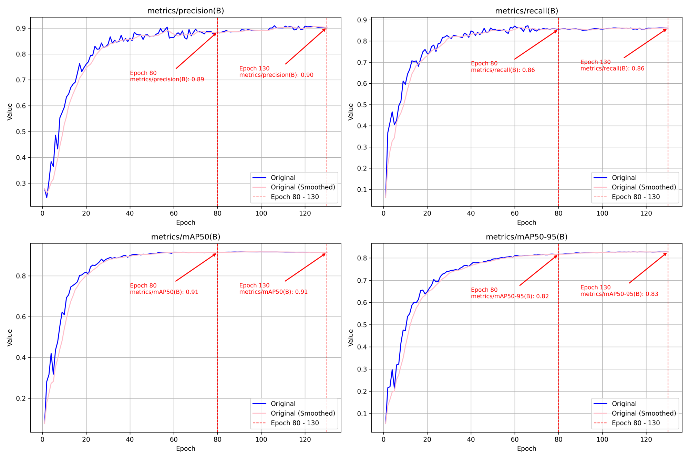
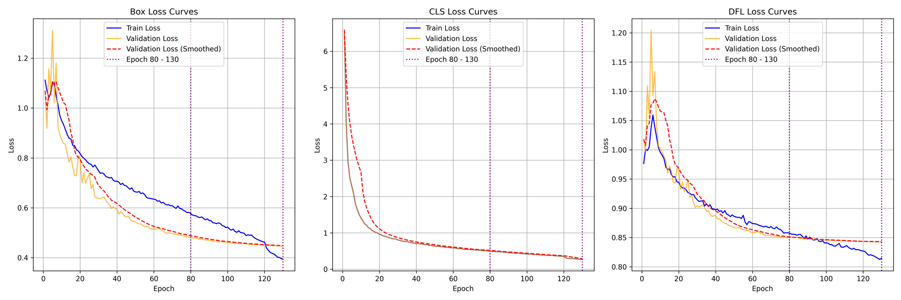
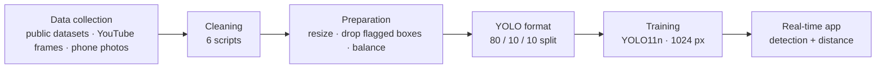

# Moroccan Traffic Sign Detection

**Real-time detection of 40 types of road signs used in Morocco, with distance estimation, using YOLO11.**

[](https://www.python.org/)
[](https://docs.ultralytics.com/models/yolo11/)
[](https://opencv.org/)
[](LICENSE)



The system detects and classifies road signs in video or webcam frames, estimates the distance to each sign, and
shows the results live. It was built as our **Bachelor's final project** (Licence d'Excellence in Artificial
Intelligence) at the Faculty of Sciences Ben M'Sik, Hassan II University of Casablanca, defended on June 10, 2025.

## Results

Final model: **YOLO11n** (2.6 M parameters, 5.3 MB), 1024 px input, trained for 130 epochs.

| Precision | Recall | mAP@50 | mAP@50–95 |
|:---:|:---:|:---:|:---:|
| 0.883 | 0.862 | **0.915** | **0.828** |

<sub>Validation split, 1,358 images, 40 classes. Scores of the best epoch, read from the saved model.</sub>

| | | | |
|:---:|:---:|:---:|:---:|
|  |  |  |  |

<details>
<summary><b>Training curves</b></summary>




</details>

## How it works



1. **Collect.** Images come from several public traffic-sign datasets (the [Mapillary Traffic Sign Dataset](https://www.mapillary.com/dataset/trafficsign),
   Kaggle, Roboflow, GitHub), from frames extracted from YouTube driving videos (2 frames per second, with `yt-dlp`),
   and from our own phone photos. Labels in XML, JSON and segmentation formats were converted to one schema,
   and unlabelled images were annotated by hand in [CVAT](https://www.cvat.ai/).
2. **Clean** ([`data_preparation/`](data_preparation)). Merge the sources and remove duplicates, normalize class names,
   drop boxes smaller than 50 px, keep the classes used on Moroccan roads, and delete images left without signs.
3. **Prepare** ([notebook](notebooks/train_yolo11n.ipynb)). Resize to 1024 × 1024, remove images with occluded or
   ambiguous signs, and balance the classes: classes with fewer than 50 boxes are dropped, frequent classes are capped
   at 400 boxes, and rare classes are augmented (brightness/contrast, rotation, blur) up to 400.
4. **Train.** YOLO11n pretrained on COCO, fine-tuned for 130 epochs (SGD, lr 0.01, batch 64) on an NVIDIA T4.
5. **Run in real time** ([`scripts/realtime_detection.py`](scripts/realtime_detection.py)). A background thread reads the
   video, YOLO detects the signs, and each detection is drawn with its class, confidence and estimated distance.

### Final dataset

| Images | Train | Validation | Test | Classes |
|:---:|:---:|:---:|:---:|:---:|
| 13,584 | 10,867 | 1,358 | 1,359 | 40 |

<details>
<summary><b>The 40 classes</b></summary>

`bicycles-only` · `children` · `crossroads` · `curve-left` · `curve-right` · `double-curve-first-right` ·
`end-of-motorway` · `end-of-speed-limit-zone` · `go-straight` · `go-straight-or-turn-left` ·
`go-straight-or-turn-right` · `height-limit` · `keep-left` · `keep-right` · `maximum-speed-limit-20` ·
`maximum-speed-limit-30` · `maximum-speed-limit-40` · `maximum-speed-limit-60` · `maximum-speed-limit-80` ·
`no-entry` · `no-heavy-goods-vehicles` · `no-left-turn` · `no-overtaking` · `no-parking` · `no-right-turn` ·
`no-stopping` · `no-u-turn` · `one-way-left` · `one-way-right` · `other-danger` · `parking` ·
`pedestrians-crossing` · `pedestrians-only` · `road-bump` · `roadworks` · `roundabout` · `slippery-road-surface` ·
`stop` · `traffic-signals` · `yield`

The class ids used by the model are listed in [`configs/traffic_signs.yaml`](configs/traffic_signs.yaml).

</details>

### Distance estimation

The distance to a sign is estimated from the height of its bounding box with the pinhole camera model:

```
distance (m) = sign_height (m) × focal_length (px) / box_height (px) − offset (m)
```

The defaults (sign height 0.7 m, focal length 800 px, offset 3.5 m) were tuned on our test videos. They give a rough
estimate, not a calibrated measurement. For accurate distances, measure your camera's focal length and pass it with
`--focal_length`.

## Experiments

We trained five models while the dataset evolved. Each run used a different version of the dataset (number of
classes), so the scores show the progress of the project rather than a direct comparison of architectures.

| Date | Model | Classes | Image size | Epochs | Precision | Recall | mAP@50 | mAP@50–95 |
|---|---|:---:|:---:|:---:|:---:|:---:|:---:|:---:|
| 2025-05-07 | YOLOv8s | 42 | 960 | 30 | 0.800 | 0.811 | 0.842 | 0.708 |
| 2025-05-18 | YOLOv8n | 68 | 640 | 150 | 0.907 | 0.815 | 0.878 | 0.760 |
| 2025-05-19 | YOLOv8n | 48 | 640 | 160 | 0.902 | 0.785 | 0.871 | 0.752 |
| 2025-06-06 | YOLO11n | 49 | 640 | 250 | 0.885 | 0.753 | 0.833 | 0.728 |
| **2025-06-07** | **YOLO11n (final)** | **40** | **1024** | **130** | **0.883** | **0.862** | **0.915** | **0.828** |

The weights of every run are attached to the [latest release](../../releases/latest).

## Quick start

```bash
git clone https://github.com/badrafyf77/moroccan-traffic-sign-detection.git
cd moroccan-traffic-sign-detection
pip install -r requirements.txt
```

**Detect signs in images** (saves annotated copies to `predictions/`):

```bash
python scripts/predict_image.py --source path/to/image_or_folder
```

**Real-time detection on a video or a webcam:**

```bash
python scripts/realtime_detection.py --source path/to/video.mp4
python scripts/realtime_detection.py --source 0 --use_gpu      # webcam, on GPU
python scripts/realtime_detection.py --source path/to/video.mp4 --record
```

| Option | Default | Description |
|---|---|---|
| `--model` | `weights/yolo11n_traffic_signs.pt` | YOLO weights to use |
| `--thresh` | `0.5` | Minimum confidence to show a detection |
| `--skip_frames` | `2` | Process one frame out of N (video files) |
| `--use_gpu` | off | Run the model on a CUDA GPU |
| `--record` / `--record_path` | off / `detections.avi` | Save the annotated video |
| `--focal_length` · `--sign_height` · `--distance_offset` | `800` · `0.7` · `3.5` | Distance calibration |

Keys while running: **Q** quit · **S** pause · **P** save the current frame.

## Train it yourself

1. Gather the source datasets in one folder and run the cleaning scripts in order
   (see [`data_preparation/README.md`](data_preparation/README.md)).
2. Open [`notebooks/train_yolo11n.ipynb`](notebooks/train_yolo11n.ipynb) and run it from top to bottom.

Or train directly from a prepared YOLO dataset with the same settings as the final model:

```bash
yolo detect train model=yolo11n.pt data=configs/traffic_signs.yaml epochs=130 imgsz=1024 batch=64 \
     optimizer=SGD lr0=0.01 weight_decay=0.0005 warmup_epochs=5
```

## Repository structure

```text
moroccan-traffic-sign-detection/
├── assets/demo.gif                  demo used in this README
├── configs/traffic_signs.yaml       dataset config with the 40 class ids
├── data_preparation/                cleaning scripts, run in order (01 → 06)
├── docs/report_fr.pdf               full project report (French)
├── notebooks/train_yolo11n.ipynb    preparation, balancing, YOLO conversion and training
├── results/                         training curves and example predictions
├── scripts/
│   ├── predict_image.py             detection on images
│   └── realtime_detection.py        real-time detection with distance estimation
├── weights/yolo11n_traffic_signs.pt final model
└── requirements.txt
```

## Report and presentation

- Project report (French, 103 pages): [`docs/report_fr.pdf`](docs/report_fr.pdf)
- Defense slides and the full demo video: attached to the [latest release](../../releases/latest)

## Authors

- **Afyf Badreddine**: [github.com/badrafyf77](https://github.com/badrafyf77)
- **Chabbaki Ayman**

Supervised by Pr. Mohamed Ghazouani, co-supervised by Dr. Taoufik Amzil.

## License

The code is released under the [MIT License](LICENSE). The training data includes images from the Mapillary Traffic
Sign Dataset (CC BY-NC-SA 4.0), so the model weights are shared for **non-commercial use** under the same terms.

## Acknowledgments

[Ultralytics](https://github.com/ultralytics/ultralytics) · [Mapillary Traffic Sign Dataset](https://www.mapillary.com/dataset/trafficsign) ·
[Albumentations](https://albumentations.ai/) · [CVAT](https://www.cvat.ai/) · [OpenCV](https://opencv.org/)
